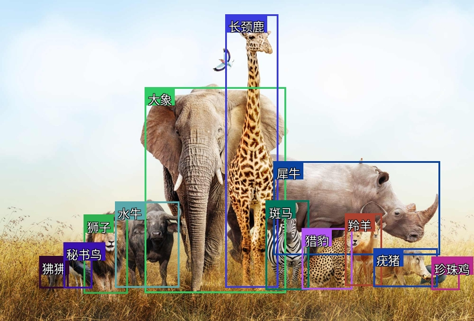

# Cajas de delimitación con Gemini

Esta aplicación de Streamlit te permite cargar una imagen, enviarla a la API de Gemini para la detección de cajas de delimitación y visualizar los resultados con las cajas etiquetadas dibujadas directamente sobre la imagen.
README generado automáticamente. Debería ser muy sencillo de seguir.

Captura de pantalla de ejemplo:



## Características

- Carga imágenes en formato JPG, JPEG o PNG.
- Envía un prompt a la API de Gemini para detectar objetos y devolver las coordenadas de las cajas de delimitación.
- Visualiza las cajas de delimitación detectadas en la imagen con etiquetas personalizables.
- Descarga la imagen procesada con las cajas de delimitación.

## Requisitos previos

Antes de ejecutar la aplicación, asegúrate de tener lo siguiente instalado:

- Python 3.9 o posterior
- Una clave API de Gemini válida

### Instalar los paquetes de Python requeridos

Instala los paquetes de Python necesarios utilizando `pip`:

```bash
pip install streamlit Pillow google-generativeai
```

## Ejecutar la aplicación

1. **Clonar el repositorio:**

   ```bash
   git clone https://github.com/AlexZhangji/bonding_w_geimini.git
   cd bonding_w_geimini
   ```
2. **Ejecutar la aplicación de Streamlit:**
   Inicia la aplicación con el siguiente comando:

   ```bash
   streamlit run bbox.py
   ```
3. **Ingrese su clave API de Gemini:**

   - En la barra lateral, ingresa tu clave API de Gemini en el campo de entrada. Esta clave es necesaria para interactuar con la API de Gemini.
4. **Cargar una imagen:**

   - Haz clic en "Browse files" para cargar una imagen JPG, JPEG o PNG desde tu equipo.
5. **Ingresar un prompt:**

   - Escribe un prompt en el área de texto que describa cómo deseas que la API de Gemini detecte los objetos y devuelva las cajas de delimitación.
6. **Procesar la imagen:**

   - Haz clic en el botón "Process" para enviar la imagen y el prompt a la API de Gemini.
   - Espera los resultados, que mostrarán la imagen con las cajas de delimitación dibujadas alrededor de los objetos detectados.
7. **Descargar la imagen procesada:**

   - Después del procesamiento, puedes descargar la imagen con las cajas dibujadas haciendo clic en el botón "Download Image with Bounding Boxes".
